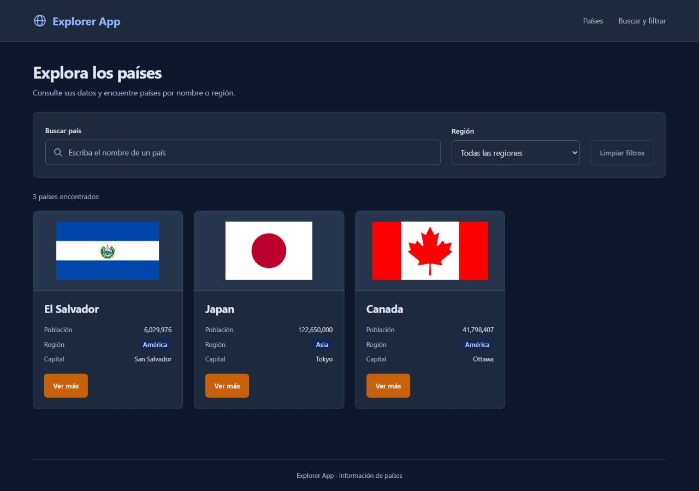

# Explorer App con React — Yonatan Chicas

Proyecto desarrollado con **React 18, TypeScript, Vite y Tailwind CSS v4**. Utiliza los tres países de demostración de clase: El Salvador, Japan y Canada, con datos y banderas locales.

## Cómo ejecutar

Necesita **Node.js 22.12 o 24**, **Git** y **pnpm**. Si no tiene pnpm, instálelo una vez con `npm install -g pnpm@11.25.0`.

Abra una terminal y ejecute:

```bash
git clone https://github.com/YonatanC31/explorer-react.git
cd explorer-react
pnpm install --frozen-lockfile
pnpm run dev
```

Abra la dirección que aparece en la terminal, normalmente **http://127.0.0.1:5174/**. Mantenga la terminal abierta mientras utiliza la aplicación. No abra `index.html` directamente.

En Windows, después de descargar el proyecto y tener los requisitos instalados, también puede abrir **`iniciar.cmd`** para instalar las dependencias e iniciar la aplicación.

## Qué incluye

Búsqueda inmediata por nombre, filtro por región combinado, mensaje sin resultados y menú móvil. Las tarjetas muestran bandera, nombre, población, región y capital, con respaldo para los datos ausentes. El diseño admite cuatro tarjetas por fila en escritorio y se adapta a móvil; la muestra de clase contiene tres países.

Para comprobar los filtros, busque `can` y elija América: aparece Canada. Cambie a Asia: aparece el mensaje sin resultados. Pulse «Restablecer filtros» para recuperar los tres países. «Ver más» muestra el código del país en la consola.

## Organización

- **Átomos:** `Flag`, `Badge`, `Button`, `Icon` y `CountryFact`.
- **Moléculas:** `CountryCard`, `SearchBar`, `RegionFilter`, `Navigation` y `EmptyState`.
- **Organismos:** `Header` y `CountryGrid`.

`CountryGrid` recibe `countries: Country[]` y `onSelect: (code: string) => void`. Crea las tarjetas con `map()`, utiliza el código del país como `key` y pasa cada país y el callback a `CountryCard`, que utiliza `Flag` y `Badge`.

`App.tsx` mantiene `query`, `region` e `isMenuOpen`. `Header` muestra `children` y transmite los valores y callbacks a los controles hijos. Los datos de clase están en `src/data/countries-demo.ts`, los tipos en `src/types/` y las utilidades en `src/utils/`.

## Captura



## Comprobaciones

```bash
pnpm run lint
pnpm test
pnpm run build
```

Las 27 pruebas comprueban filtros, callbacks, menú y datos ausentes. `build` comprueba TypeScript y genera `dist/`. `.gitignore` excluye `node_modules` y `dist`.

## Entrega

- [Rama de entrega: entrega-s24-s27](https://github.com/YonatanC31/explorer-react/tree/entrega-s24-s27).
- [Guion para el video obligatorio de 3 a 5 minutos](./docs/guion-video.md).
- [Detalles técnicos, fuente de datos y comprobación de requisitos](./docs/detalles-tecnicos.md).

Comparta el enlace del repositorio y su video en Canvas. Esta versión utiliza datos locales y no requiere una API ni React Router.
